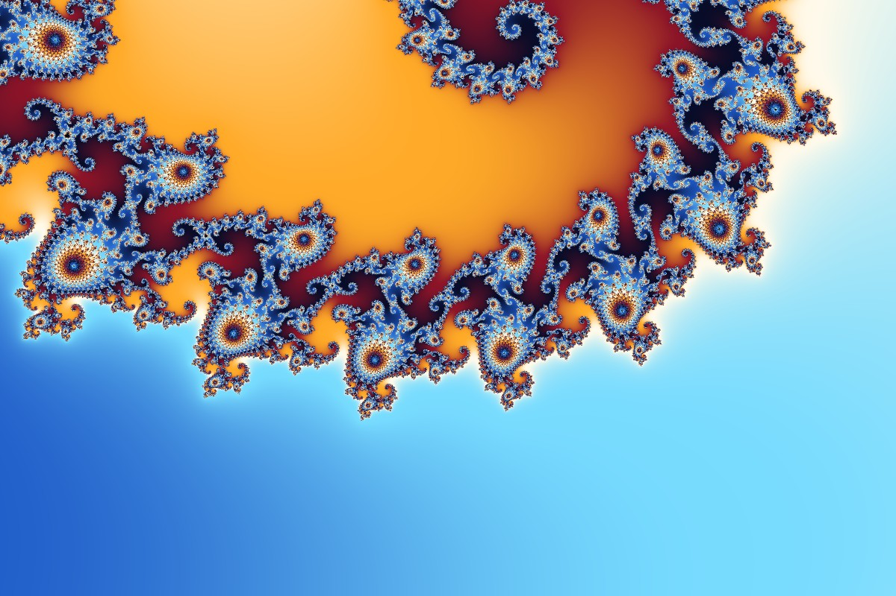

# Introduction

RFract is a 2D fractal generator. It builds images from layers of fractals – each with its own
formula, coloring, gradient, merge mode and mask – renders them on the graphics card, and turns
them into stills and animations with glow, chromatic aberration, lighting and denoising.

This manual describes version {{version}}, an early development version: layers with merge
modes, groups and masks, 552 built-in formulas, 13 coloring algorithms, 11 transformations,
gradients with opacity, GPU rendering with automatic double precision for deep views, and PNG
export with transparency. Effects, deep zoom beyond double precision and animation follow in
later versions.

## Related programs

RFract is the third program of a family:

- **RWildFire** – fractal flames (a Rust port of JWildfire).
- **RMandelbulb3D** – 3D fractals (a Rust re-implementation of Mandelbulb3D).
- **RFract** – 2D fractals with layers.

The three share their look, their way of working and the denoiser.
