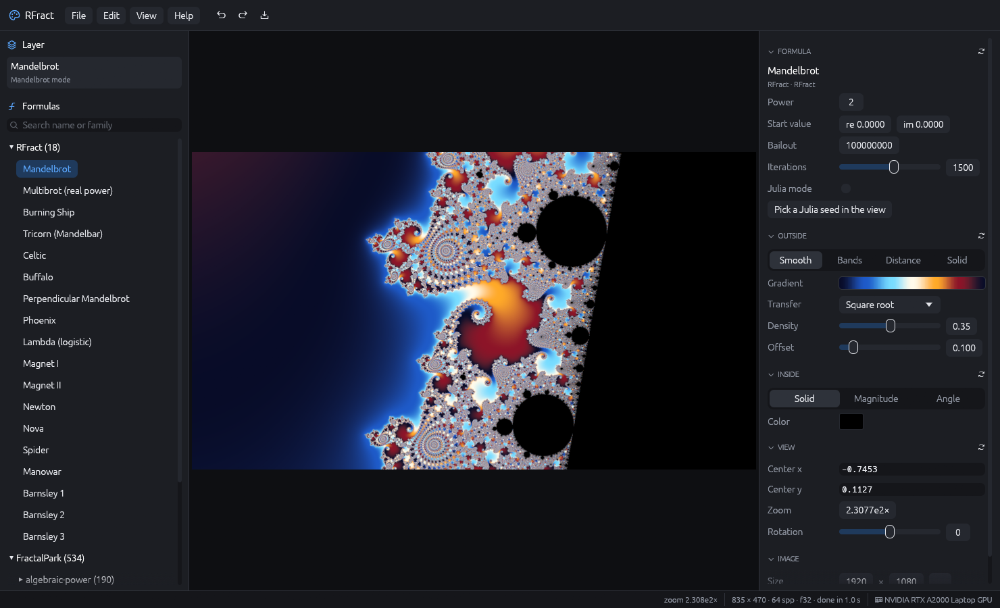

# Getting started

The window has four parts:

- **Left**: the layer and the **formula browser**. Click a formula to use it; the view jumps
  to the region the formula suggests.
- **Center**: the **view**. It shows the image in the aspect ratio of the export size and
  refines while you look: the first pass appears at once, further passes smooth the edges.
- **Right**: the **inspector** with the settings of the layer: formula parameters, iterations,
  Julia mode, the coloring of the outside and the inside, the view and the image size.
- **Bottom**: the status bar with messages, the coordinate under the cursor, the
  magnification, the preview's size and samples, the arithmetic the shader uses and the
  graphics card.

Every control explains itself when you hold the mouse over it. Double-click a slider to reset
it.

## A first picture

1. Start RFract: it opens with the Mandelbrot set.
2. Turn the mouse wheel over the view to zoom in at the cursor, drag to move.
3. Change the colors on the right: try **Density** and **Offset** under *Outside*, or click the
   gradient to edit it.
4. Press **Ctrl+E** to export the image. The PNG also holds all settings: open it again with
   **Ctrl+O** to continue where you left off.

!!! tip
    **Ctrl+Z** undoes every change, including moves and zooms of the view: it doubles as the
    zoom history.
