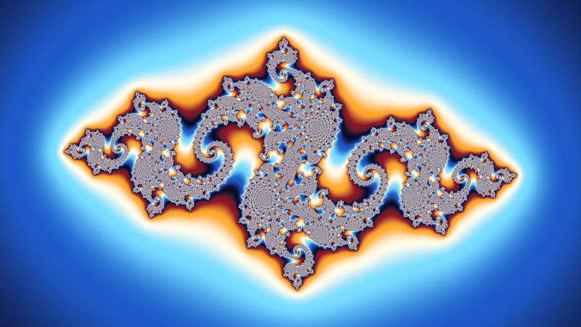

# The view

## Navigation

| Input | Action |
|-------|--------|
| Drag | Move the view |
| Mouse wheel | Zoom in or out at the cursor |
| Shift+drag, right drag | Zoom into the box you draw |
| Ctrl+drag | Rotate the view around its center |
| Double-click | Zoom in by two at the point |
| Right click | Zoom out by two |
| Alt+click | Julia set of the point (Alt+click again goes back) |
| J | Julia set of the point under the cursor, or back |
| Home | Back to the formula's suggested view |

While you navigate, the preview renders at a lower resolution (Preferences › Preview › While
navigating) and switches back to full resolution once you stop.

The *View* section of the inspector shows the center (as text, with as many digits as the
zoom needs), the magnification and the rotation. Type exact coordinates there to go to a known
place.

## Julia sets

Formulas with a Mandelbrot/Julia switch iterate in two ways:

- **Mandelbrot mode**: every point of the plane is the formula's constant *c*; the image is a
  map of all Julia sets.
- **Julia mode**: *c* is one fixed seed and every point is the start value; the image is the
  Julia set of that seed.

Alt+click a point (or press **J** over it) to see its Julia set; the seed is the point you
clicked. **Pick a Julia seed in the view** in the inspector does the same with the next click.
Switching back restores the view you left. The seed can also be typed or dragged in the
inspector.

## Precision

The graphics card computes with 32-bit floating point numbers while that is precise enough.
Zoom in further (beyond a few thousand times at full HD) and RFract switches to double-float arithmetic (two 32-bit
numbers per value, about 48 bits), which stays clean to about 10¹² at full HD. The status bar
shows the arithmetic in use (*f32*, *f32 + derivatives* for distance estimation, or
*double-float*).

!!! note
    Deeper views show rounding steps; the status bar warns about it. Zooms beyond double
    precision come with a later version (perturbation). Distance estimation needs 32-bit
    arithmetic in this version: in double-float views it colors by the smooth iteration count.
