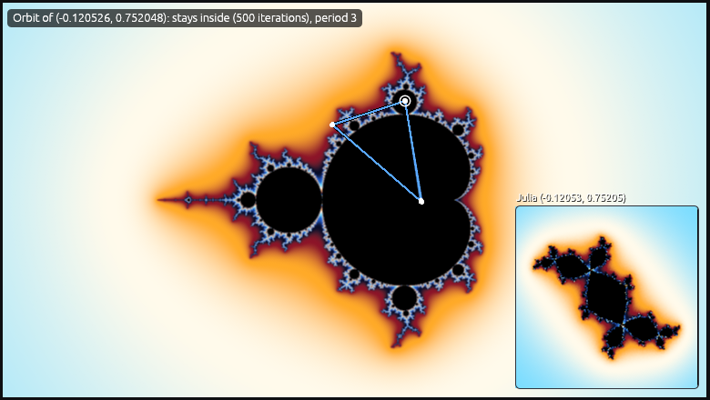

# The view

## Navigation

| Input | Action |
|-------|--------|
| Drag | Move the view |
| Mouse wheel | Zoom in or out at the cursor |
| Shift+drag, right drag | Zoom into the box you draw |
| Ctrl+drag | Rotate the view around its center |
| Double-click | Zoom in by two at the point |
| Right click | Zoom out by two |
| Alt+click | Julia set of the point (Alt+click again goes back) |
| J | Julia set of the point under the cursor, or back |
| Home | Back to the formula's suggested view |
| F | Fly mode on or off |
| O | Orbit display on or off |
| I | Julia preview inset on or off |

### Fly mode

In fly mode (*View › Fly mode* or F) you fly through the fractal: hold the left mouse button
to fly in toward the cursor, the right button to fly out; steer by moving the mouse. The
speed builds up gently when you press a button and runs out gently when you let go, like a
real drive. The mouse wheel sets the speed (zoom steps of two per second, shown at the bottom
left of the view). Ctrl+drag still orbits the camera of a 3D terrain. The timeline can record
a flight as an animation (see *Animation*).

Over a 3D terrain (the selected layer), fly mode moves the camera through the landscape
instead:

| Input | Action |
|-------|--------|
| W / S or ↑ / ↓ | Fly forward and back, the way the camera looks |
| A / D or ← / → | Fly sideways |
| E / Q or Page Up / Page Down | Rise and sink |
| Shift | Four times faster |
| Drag | Look around (the camera turns where it is) |
| Wheel | Speed (image heights per second) |

The keys work while the view has the keyboard (not while you type in a field); the moves ramp
up and down like the flight into the fractal, and a flight recording follows them.

While you navigate, the preview renders at a lower resolution (Preferences › Preview › While
navigating) and switches back to full resolution once you stop.

The *View* section of the inspector shows the center (as text, with as many digits as the
zoom needs), the magnification and the rotation. Type exact coordinates there to go to a known
place, and any magnification such as `1e500` (the status bar shows it as `zoom 1.500e30×`).

## Bookmarks

*View › Bookmarks* keeps places of the document to come back to. **Ctrl+B** (or *Add the
current view* in the window) saves the view (center, zoom and rotation) as a bookmark; each one
shows a thumbnail, its name and zoom. Click the thumbnail to go there, type a new name,
**Update** it to the current view, move it up or down, or remove it. Bookmarks are saved with
the document, at any depth. On the command line, `rfr-cli render picture.rfr --bookmark
"Seahorse"` renders a bookmark's view (into `picture-Seahorse.png` without `-o`).

## Julia sets

Formulas with a Mandelbrot/Julia switch iterate in two ways:

- **Mandelbrot mode**: every point of the plane is the formula's constant *c*; the image is a
  map of all Julia sets.
- **Julia mode**: *c* is one fixed seed and every point is the start value; the image is the
  Julia set of that seed.

Alt+click a point (or press **J** over it) to see its Julia set; the seed is the point you
clicked. **Pick a Julia seed in the view** in the inspector does the same with the next click.
Switching back restores the view you left. The seed can also be typed or dragged in the
inspector.

### Julia preview

*View › Julia preview* (or **I**) shows a small Julia set of the point under the cursor in
the lower right corner of the view while you move the mouse over the Mandelbrot mode of the
selected layer. It renders in the background with at most 1000 iterations and follows the
cursor; the view does not move or zoom under the inset. Click the inset to open that Julia
set (like Alt+click).

## Orbit display

*View › Orbit display* (or **O**) draws the orbit of the point under the cursor for the
selected layer: the point after the layer's transformations (the ring) and the values of *z*
the formula goes through, joined by lines (the first 2000 values). The line at the top left
tells whether the orbit escapes and after how many iterations, or that it stays inside, with
the length of the cycle it settles into when there is one (period 1 in the main cardioid,
2 in the large bulb on its left, and so on).

!!! note
    The orbit is computed in double precision without the early inside tests. Beyond double
    precision it is the orbit of the nearest point double precision can hold.

## Precision

The graphics card computes with 32-bit floating point numbers while that is precise enough.
Zoom in further (beyond a few thousand times at full HD) and RFract switches to double-float arithmetic (two 32-bit
numbers per value, about 48 bits), which stays clean to about 10¹² at full HD. The status bar
shows the arithmetic in use (*f32*, *f32 + derivatives* for distance estimation,
*double-float*, *double-float + derivatives* or *perturbation*).

## Deep zoom

Beyond double precision RFract renders by **perturbation**: one reference orbit at the view
center is computed with as many digits as the depth needs, and every pixel follows only its
small difference to it, with numbers whose exponent goes far beyond 10⁻³⁰⁸. There is no
depth limit: views at 10⁻¹⁰⁰⁰ work like any other. While you navigate, the reference orbit
stays the same as long as it is near and precise enough, so zooming does not wait for it;
when you move far away, a new one is computed in the background (the status bar shows
*reference orbit…*) while the old one keeps rendering.

Deep views need many iterations: raise *Iterations* until the black regions show detail (the
center of a spiral often needs tens of thousands). Most of them are skipped: where the
difference to the reference stays small, RFract jumps over hundreds or thousands of
iterations at once with precomputed linear steps (*bilinear approximation*), so a full HD
image at 10⁻³⁰ with 50 000 iterations takes seconds. Coloring algorithms that look at every
iteration (orbit traps and the like), post-transformations and distance estimation need all
of them and render slower at depth. The linear steps also work for formulas that carry
more than `z` from one iteration to the next: values kept from `init` (such as the pixel
stored in a variable) and further changing variables (Phoenix and its previous `z`), up to
four of them. Formulas with quotients in the loop iterate every step.

Distance estimation works at every depth: in double-float views the derivatives ride along
in 32-bit numbers, in perturbation views they follow the differences to the reference with
the same unlimited exponent.

Perturbation works for formulas built from sums, products, quotients, whole-number powers,
`conj`, `abs`, `real`, `imag` and `flip` with variables that do not depend on conditions in the
loop: Mandelbrot and its powers, Burning Ship, Tricorn, Celtic, Buffalo, Perpendicular, many
user formulas. RFract derives the perturbed formula itself; nothing has to be written twice.

!!! note
    Layers whose formula cannot be perturbed (functions such as `sin` or `exp`, conditions
    that depend on the orbit, integer variables) or that use transformations show rounding
    steps beyond double precision; the status bar warns and its hover text names them.
