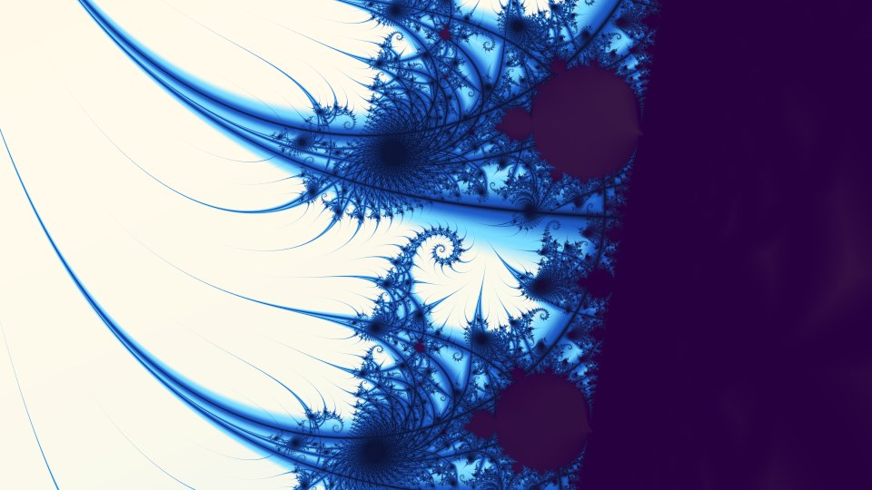
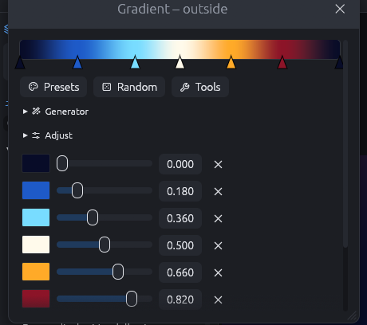

# Coloring

Every point either escapes (the **outside**) or stays bounded until the iteration limit (the
**inside**). Both get their own coloring.

## Outside

| Method | Value |
|--------|-------|
| Smooth | Continuous iteration count: the iteration the point escaped at, plus how far beyond the bailout it landed. Convergent formulas (Newton, Magnet) use how fast the orbit settled. |
| Bands | The plain iteration count: one band per iteration. |
| Distance | The estimated distance to the set, relative to the pixel size (computed with automatic derivatives of the formula). Thin filaments stay visible. |
| Formula | A coloring algorithm (see below). |
| Solid | One color (with an opacity: 0 leaves the region transparent). |

The value goes through the **transfer** function (linear, square root, cube root,
logarithm, square, histogram), is multiplied by the **density** (gradient repetitions per
unit) and shifted by the **offset**, and then picks a color from the gradient. The gradient
repeats.

### Histogram coloring

The *Histogram* transfer replaces the value by the share of the region's pixels in the view
whose value is lower: 0 for the lowest, 1 for the highest. Every part of the gradient then
covers about as many pixels, wherever the values crowd: no washed-out areas where many
pixels share a few iterations, no hidden colors where few reach high values. Density 1
shows the gradient once over the view (choosing *Histogram* sets it); higher densities
repeat it.

The distribution comes from a small probe of the layer over the whole view (about 16,000
pixels), so the preview, exports of any size and tiled posters color alike. It changes with
the view: zooming or panning shifts the colors, also in animations. It works for the outside
and the inside, for every method with a value (also coloring algorithms) and for masks; 3D
objects keep their values as they are.

## Inside

| Method | Value |
|--------|-------|
| Solid | One color (black by default). |
| Magnitude | The size of *z* after the last iteration. |
| Angle | The direction of *z* after the last iteration. |
| Formula | A coloring algorithm (see below). |

## Coloring algorithms

The *Formula* method runs a coloring algorithm along every orbit. Pick it under
*Algorithm*; its parameters follow.

| Algorithm | Colors by |
|-----------|-----------|
| Orbit trap | The closest approach of the orbit to a point, line, circle, cross, square, spiral, astroid or heart (distance, iteration, angle or size there) |
| Triangle inequality average | How ‖z²‖ + ‖c‖ compares with ‖z² + c‖ along the orbit, smoothed |
| Curvature average | The average turning angle of the orbit |
| Stripe average | The average of sin(stripes · angle of z): stripes that follow the orbit |
| Exponential smoothing | A sum of exp(−‖z‖) (escaping) or exp(−1/‖Δz‖) (converging orbits) |
| Binary decomposition | The sign of Im(z) at escape |
| Field lines | The angle of z at escape, repeated |
| Decomposition (angle) | The angle of z at the end |
| Gaussian integer | The distance of the orbit to the nearest lattice point |
| Pickover stalks | The distance of the orbit to two axes: thin stalks |
| Epsilon cross | The first iteration close to an axis |
| Closest approach (bof60) | The smallest ‖z‖ of the orbit |
| Iteration of closest approach (bof61) | The iteration of the smallest ‖z‖ |
| Lyapunov exponent | For the *Lyapunov* formula: stable points along the gradient, chaotic ones solid |
| Gradient fill | The gradient across the plane, linear, radial or conical (with the *Pixel* formula: a fill layer) |
| Image | An image file, looked up by the final *z*, the pixel or the orbit's closest approach to a center (an image trap); with size, angle, proportions and tiling. The gradient shows where the image is transparent |
| Image along the bands | An image laid along the iteration bands: its width across each band (smooth iteration count), its height around the set (angle of *z*) |
| Noise pattern | Value noise, Perlin noise, Voronoi cells or fractal noise (octaves of Perlin noise) over the final *z*, the pixel or the closest approach; optionally added to the smooth iteration bands |

Algorithms can mark points as *solid* (for example outside a trap): those get the solid color
below the gradient, which can also be transparent.

!!! tip
    Textures as bumps: color a layer with *Noise pattern* (or any algorithm), switch on
    *Lighting* and take the heights from *Coloring*: the pattern becomes a relief. A small
    *Relief* (0.02 to 0.1) suits fine patterns.

Coloring algorithms are formulas in UFM syntax (`formulas/rfract/rfract.ucl`): `init:` runs
once, `loop:` after every iteration, `final:` at the end; they read `#z` and write `#index`
(the gradient position), `#solid` or `#color` (a direct color, see *Formula files* in the Formulas chapter). *Direct color (hue by angle)* is an example
of a direct coloring: it composes hues over the gradient and multiplies a tint color, *Image*
another one: it reads an image file through an image parameter.

## The gradient editor

Click a gradient in the inspector to edit it.

{: .half}

- **The strip**: drag a marker to move its color, click the strip to add a color there,
  right-click or double-click a marker to remove it.
- **Presets** and saved palettes; save the current colors under a name.
- **Random** makes a new palette with the generator's settings.
- **Generator**: harmony (analogous, complementary, triadic, …), number of colors, hue,
  saturation and lightness ranges, order, hardness and seamless repetition.
- **Adjust**: hue, saturation, lightness, contrast and hardness of the whole palette.
- **Tools**: reverse, shift, mirror, repeat, space evenly, sort by lightness, invert
  lightness, hard steps, smooth blends.
- **Opacity**: points with a position and an opacity make parts of the gradient transparent,
  so the layers below show through; the strip shows a checkerboard there.
- **Import** reads gradients from `.ugr` (several per file, with opacity), `.map`, `.ggr`,
  `.gpl` and `.cpt` files; **Export** writes `.ugr`, `.map` or `.ggr`.
- **Blend**: smooth (eased) or linear blends. Colors always blend in the perceptual OKLab
  space, so gradients keep even brightness steps.

## Color cycling

The play button in the top bar (or *View › Cycle colors*) turns all gradients in the view;
the speed and direction are in the View menu. The document keeps its colors: cycling is only
for looking (and animations will use it later).

## Lighting

The *Lighting* section turns a layer into a relief: its values become heights, and lights
shine on it from above. Switch on **Lit** and choose where the heights come from:

| Height | From |
|--------|------|
| Iterations | The smooth iteration count (logarithmic). Points near the set lie higher; the set itself is a plateau. |
| Coloring | The coloring value, the position in the gradient: the relief follows the color bands. |
| Brightness | The brightness of the layer's color. On an image layer this gives a bump map of the image. |
| Distance | The estimated distance to the set (logarithmic): smooth slopes that rise toward the set, independent of the iteration bands. Needs derivatives like the *Distance* coloring; in very deep views it falls back to flat ground. |

- **Relief** sets how steep the slopes are; negative values turn the relief inside out. The
  relief keeps its look when you render the same view at another size.
- **Ambient** is light from all directions; it keeps the sides turned away from the lights
  from going black.
- **Highlights** and **Roughness** shape the shine: low roughness gives small, glossy
  highlights, high roughness wide and dull ones. *GGX* highlights have soft tails,
  *Blinn-Phong* ones a tighter falloff.
- **Shadows**: higher parts of the relief cast shadows away from each light. *Shadow length*
  is how far they reach (a share of the image height), *Softness* the size of the lights:
  0 gives sharp edges, larger values soft ones. Low lights cast long shadows.
- **Occlusion** darkens hollows and the foot of slopes, where less light comes from all
  around; *Occlusion radius* is how far around each point it looks.
- **Reflection** mirrors the surroundings: 0 not at all, 1 like a mirror (a little more where
  the slopes are steep). *Environment* is a panorama image (2:1, equirectangular, the sky at
  the top) or, without one, a sky from *Sky horizon* (reflected by steep slopes) to *Sky
  zenith* (reflected by flat parts).
- Up to four **lights**, each with a direction (degrees counterclockwise from the right edge of
  the image), a height above the image (low lights rake across the relief), an intensity and a
  color. *+ Light* adds one from the opposite side.
- **Document lights** lets the light sources of the *Lights* section (see *Effects*) light
  the layer too, as points: each lights the relief from its position in the plane and its
  *Height*, so slopes facing it brighten and shadows fall away from it (no farther than the
  light). Up to four light sources count; their *Reach* makes them dimmer with distance. 3D
  objects have the same switch (the view's plane is the ground through the object).

### 3D terrain

**3D terrain** shows the relief as a landscape: a camera looks at it from the side instead of
from straight above. The terrain is the part of the plane the 2D view shows, so moving and
zooming the view moves and scales the landscape under the camera. *Camera direction* turns the
camera around the middle of the terrain (0: from the bottom edge of the image), *Camera
height* is its angle above the ground, *Camera distance* its distance in image heights and
*Field of view* its opening angle. While the terrain layer is selected, **Ctrl-drag** in the
view orbits the camera (left and right: direction, up and down: height) and **Ctrl-wheel**
moves it closer or farther; plain dragging and the wheel still move and zoom the plane under
it. Where no terrain is seen, the layer is transparent: the layers below and the background
show, for example a gradient fill layer as a sky. The terrain is an open sheet: its edges have
no walls.

**Terrain height** (instead of *Relief*) sets how high the terrain's highest parts rise, as a
share of the image height: with *Iterations* the set is a plateau at exactly that height,
with *Distance* the slopes rise smoothly to the set at that height. The lights, shadows,
occlusion and reflections work on the terrain as on the flat relief. Very steep walls show
the colors of the few pixels they stand on, stretched; a lower terrain height or *Distance*
heights avoid them. The terrain has as many
points as the image has pixels, so close-ups of the ground look soft.

Every render pass computes the layer's heights over the whole image before it shades it, so
a lit layer costs a little more than an unlit one; shadows and occlusion sample the heights
around each pixel and get smoother with every pass. Editing the lights and the relief does
not recompile anything.

!!! tip
    For a classic "slope" look, color the outside by *Smooth*, light it with *Iterations* and
    one low light (height 20° to 30°); a second, weak, colored light from the other side
    fills the shadows.
