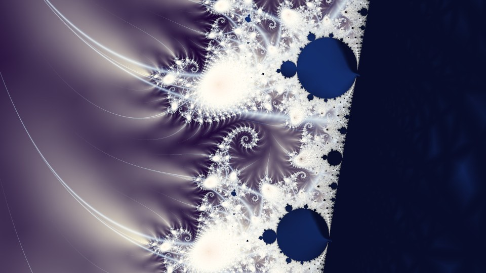
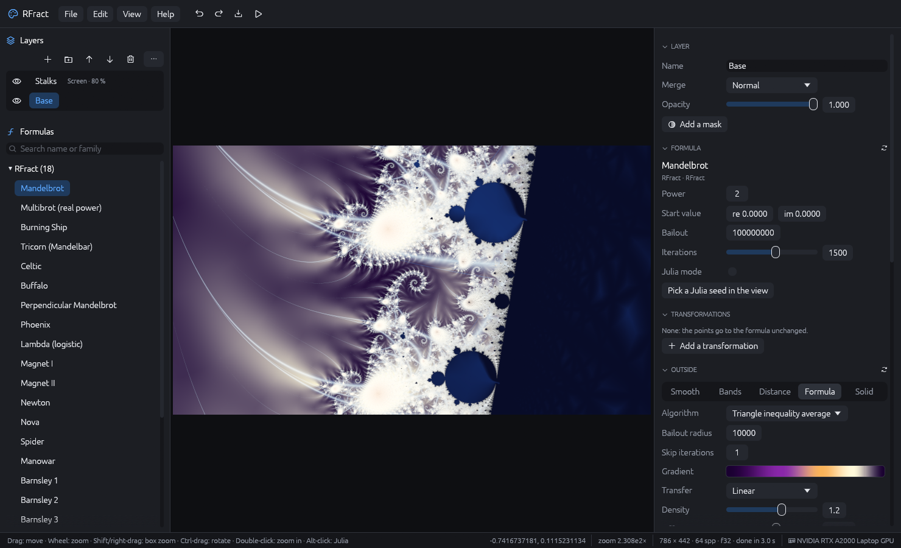

# Layers

An image is a stack of layers. Every layer computes its own fractal (formula,
transformations, colorings) over the same view, and the stack combines them from the bottom
up, over the background color.

## The layer list

The list shows the top of the stack first. Click a layer to edit it: the formula browser and
the inspector work on the selected layer.

| Button | Action |
|--------|--------|
| + | A new fractal layer above the selected one (same colors, Screen mode) |
| Folder | A new group above the selected layer |
| ↑ ↓ | Move the selected layer up or down |
| Bin | Delete the selected layer (or its mask) |
| … | Duplicate, group, ungroup, add a mask |
| Eye | Show or hide a layer |

## Merge modes and opacity

The *Layer* section of the inspector sets how a layer combines with the layers below it:

- **Opacity** from 0 (hidden) to 1.
- **Merge mode**: Normal, Multiply, Screen, Overlay, Soft light, Hard light, Color dodge,
  Color burn, Darken, Lighten, Difference, Exclusion, Add, Subtract, Hue, Saturation, Color
  and Luminosity. They work like the layer modes of image editors (on sRGB colors, after the
  W3C compositing rules); the hover text of each mode describes it.

Transparent parts of a layer let the layers below show through: gradients can have an opacity
curve (see Coloring), solid colors an opacity, and transformations can leave points empty.

## Groups

A group combines its layers first and then merges the result like a single layer, with its
own merge mode, opacity and mask. Groups can hold groups.

## Masks

A mask is a fractal of its own that decides where its layer (or group) shows: bright parts of
the mask show the layer, dark parts hide it (or the other way round with **Invert**). With
**Alpha** as the source, the mask's opacity decides instead of its brightness.

Add a mask with *Add a mask* in the inspector or the … menu. The mask appears under its layer
in the list; select it to give it a formula from the browser and colors like any layer. Its
merge mode and opacity do not matter.

## Fill and image layers

The **…** menu above the layer list adds layers that do not show a fractal: *Add solid fill*
(one color), *Add gradient fill* (the gradient across the image, linear, radial or conical)
and *Add image layer* (an image file; choose it under *Outside* in the inspector). They use the
*Pixel* formula with the *Solid*, *Gradient fill* and *Image* colorings, so masks, merge modes
and transformations work on them as on any layer.

## Density layers

A **density layer** (the sparkle button above the layer list) does not color each point by
its own orbit: it draws many orbits from random start points and counts how often they pass
through every pixel. Its formula is an ordinary formula; the *Density* section in the
inspector decides which orbits count:

| Mode | Draws |
|------|-------|
| Escaping | The paths of points that escape: the **Buddhabrot** (with the Mandelbrot formula) |
| Captive | The paths of points that stay: the anti-Buddhabrot |
| Attractor | Every orbit after a warm-up: **strange attractors** (the formulas of the *Attractors* family: Clifford, de Jong, Hopalong, Gumowski–Mira, Ikeda, Tinkerbell, Pickover, Lorenz, Rössler) |
| IFS | The chaos game of an **iterated function system**: every step applies one of the layer's maps, chosen by its weight (the formula is not used) |
| Kleinian | The **limit set** of a group of two Möbius transformations and their inverses (a random walk over them; the formula is not used) |
| L-system | The strokes of an **L-system**'s turtle, antialiased (the formula is not used) |

In IFS mode the inspector lists the maps: the six coefficients (x' = a·x + b·y + e,
y' = c·x + d·y + f), the weight and a *variation* (a nonlinear function after the map, as in
fractal flames: sinusoidal, spherical, swirl, horseshoe, polar, handkerchief, heart, disc,
spiral). *Presets* holds the Sierpinski triangle, Barnsley's fern, the Heighway dragon and the
Lévy C curve; *Fit view* frames the attractor. FractInt `.ifs` files open like parameter files
(Ctrl+O): every system in the file becomes an IFS layer.

In Kleinian mode the two generators come from *Grandma's recipe* (the traces of a and b, two
complex numbers: 2 and 2 give the Apollonian gasket, a second trace of 2 gives Maskit's
groups) or from *Riley's* recipe (one complex parameter). Small changes of the traces bend the
limit set from circles into spirals and dust; *Presets* holds a few starting points.

In L-system mode the axiom is rewritten by the rules (one per line, `F=F+F--F+F`) as often as
*Rewrites* says; the turtle then draws: `F` and `D` go forward with a line, `G`, `M` and `f`
without, `+` and `-` turn by 360° divided by *Angle*, `|` turns around, `!` swaps the turn
directions, `[` and `]` save and restore the turtle. *Stroke width* is in turtle steps.
*Presets* holds the Koch snowflake, a plant, the dragon and Hilbert curves and the Sierpinski
arrowhead; FractInt `.l` files open like parameter files.

- *Shortest orbit* leaves out orbits that escape at once (they only add a haze).
- *Start region* is where the start points come from (plane units, independent of the view).
- *Orbits per pass*: more fill the image faster; every render pass adds that many.
- *Metropolis* (Escaping and Captive): for zoomed views. Uniform start points rarely send an
  orbit through a small view, so most of the work is lost. With Metropolis sampling every orbit
  slot keeps its start point from pass to pass and tries a small step (now and then a jump
  anywhere in the start region), keeping steps whose orbits cross the view more often. The
  counts are weighted so the image shows the same density as with uniform start points, only
  much sooner. Until the slots have found orbits through the view the image stays empty, and
  the first passes are grainier.
- *Nebulabrot* counts three channels with their own iteration limits (red, green, blue) and
  shows them as RGB; otherwise the gradient colors the counts, from few (left) to many (right).
- *Brightness* and *Gamma* shape the log density: the brightest pixel has full brightness.

The image gets sharper with every pass. While the counts fill up, the accumulated image starts
over each time the passes double, so early passes do not stay in it. New density layers merge
with *Screen*, so their light adds to the layers below.

## Layer effects

The *Layer effects* section of a fractal layer adds light and shadow around its shapes; they
work best on layers with transparent parts (for example the set alone, with the outside
colored *Solid* at opacity 0).

- **Drop shadow**: the layer casts a shadow on the layers below: *distance* and *blur* as
  shares of the image height, *direction* in degrees (315: toward the lower right), color.
- **Outer glow**: light around the shapes, over the layers below.
- **Inner glow**: light along the inside of the edges.
- **Neon**: light along the outside of the set, by its estimated distance (the layer then
  computes derivatives, like the *Distance* coloring); *Neon width* in pixels at 1000 pixels
  image height.

Shadows and glows are estimated from a few samples per pixel and get smoother with every
pass. For an embossed look, light the layer with heights from *Brightness* (see *Coloring ›
Lighting*). Layer effects do not apply to 3D terrains.

## 3D objects

A **3D object** layer (the cube button above the layer list) shows a three-dimensional
fractal, traced along camera rays to its surface and lit like a lit layer (see *Coloring ›
Lighting*: lights, highlights, shadows, occlusion and reflections). Shapes:

| Shape | What it is |
|-------|------------|
| Mandelbulb | z → zⁿ + c in spherical coordinates; *Power* 8 gives the classic bulb |
| Quaternion | The Julia set of q² + c over quaternions (four components), cut at w = 0; *Seed* is c |
| Mandelbox | Box and sphere folds with a *Scale* (2: a cube full of folded detail) |
| Menger | The Menger sponge |

*Iterations* sets the detail of the formula, *Julia mode* (Mandelbulb, Mandelbox) uses the
*Seed* as the constant. *Detail* is how close the rays get to the surface, in pixels:
smaller values show finer structure and take longer. The camera circles the origin:
*Camera direction*, *Camera height*, *Camera distance* and *Field of view*; in the view,
**dragging** orbits the camera and the **wheel** moves it closer or farther. Switching the
shape moves the camera so the whole shape is in view.

The surface is colored with the layer's gradient by an orbit trap (how close the orbit came
to the origin); *Colors* holds the gradient, transfer, density and offset. Where the rays
miss, the layer is transparent: a gradient fill layer below makes a sky.

## Background

*Image › Background* is the color below all layers. With its opacity at 0, exported PNGs keep
the transparency, and the view shows a checkerboard where the image is transparent.
