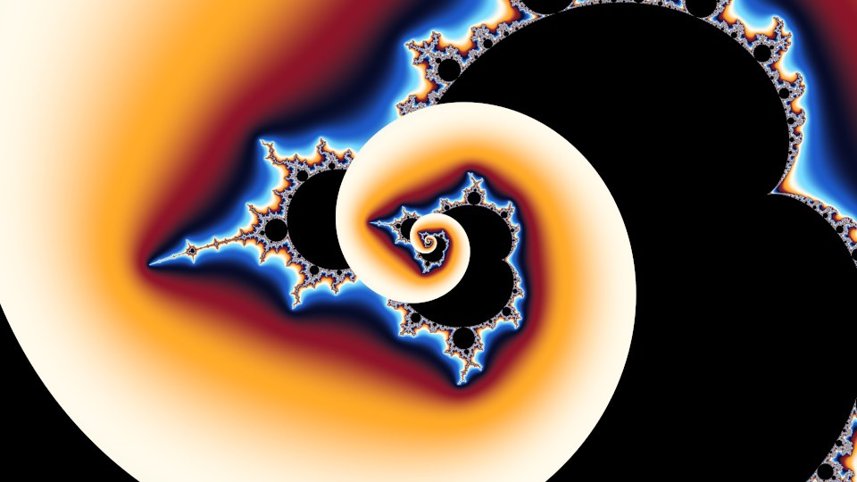

# Transformations

A transformation changes the points before the fractal formula sees them: it bends, mirrors
or repeats the plane. Add them in the *Transformations* section of a layer; several apply in
order (the arrows change the order, the checkbox switches one off).

| Transformation | What it does |
|----------------|--------------|
| Affine | Scale, rotate, shear and move |
| Mirror | Mirrors one side of a line onto the other |
| Kaleidoscope | Repeats one wedge around a center, optionally mirrored |
| Polar coordinates | Turns angle and logarithmic radius into x and y, or back |
| Circle inversion | Swaps inside and outside of a circle |
| Möbius | (a·z + b) / (c·z + d) with complex a, b, c, d |
| Riemann sphere | Rolls the plane over a sphere, so infinity can come into view |
| Tiling | Repeats a rectangle, optionally mirrored |
| Twirl | Turns the plane around a center, most at the center |
| Ripple | Concentric waves |
| Droste spiral | Winds zoom steps into a logarithmic spiral |

Transformations are formulas in UFM syntax (`formulas/rfract/rfract.uxf` in the source code):
the `transform:` section changes `#pixel`; setting `#solid = true` leaves the point
transparent.

## Post-transformations

A post-transformation changes `z` as the coloring formulas see it, not the points the fractal
starts from. The orbit itself stays the same, so the shape of the set and the escape do not
change; what changes is the pattern a coloring formula draws from the orbit. Add them in the
*Post-transformations* section of a layer; the list works like the one for transformations
and offers the same formulas.

Every value of the orbit that a coloring formula gets goes through the post-transformations
once: `#z` at the start, after every iteration and at the end, and `#zprev` with them. A
post-transformation that sets `#solid` at the end paints the point in the region's solid
color.

!!! note
    Post-transformations only affect coloring formulas (*Formula* in the *Outside* or
    *Inside* section). Smooth, bands, distance, magnitude and angle use the untransformed
    orbit. In deep zooms the layer computes every iteration (no skipped steps), so it renders
    more slowly there.

!!! tip
    Formulas that only read the angle of `z` (Stripe average, Decomposition) do not change
    under transformations that keep the angle, such as Ripple around the origin; Twirl,
    Tiling or Möbius show more.
