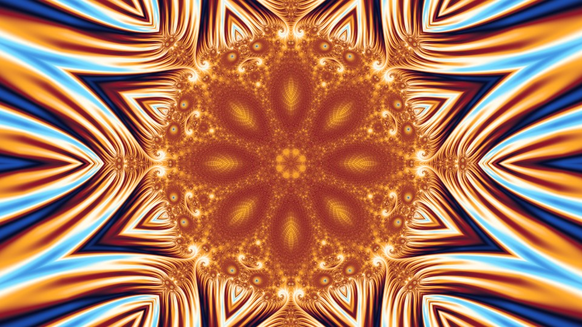

# Transformations

A transformation changes the points before the fractal formula sees them: it bends, mirrors
or repeats the plane. Add them in the *Transformations* section of a layer; several apply in
order (the arrows change the order, the checkbox switches one off).

| Transformation | What it does |
|----------------|--------------|
| Affine | Scale, rotate, shear and move |
| Mirror | Mirrors one side of a line onto the other |
| Kaleidoscope | Repeats one wedge around a center, optionally mirrored |
| Polar coordinates | Turns angle and logarithmic radius into x and y, or back |
| Circle inversion | Swaps inside and outside of a circle |
| Möbius | (a·z + b) / (c·z + d) with complex a, b, c, d |
| Riemann sphere | Rolls the plane over a sphere, so infinity can come into view |
| Tiling | Repeats a rectangle, optionally mirrored |
| Twirl | Turns the plane around a center, most at the center |
| Ripple | Concentric waves |
| Droste spiral | Winds zoom steps into a logarithmic spiral |

Transformations are formulas in UFM syntax (`formulas/rfract/rfract.uxf` in the source code):
the `transform:` section changes `#pixel`; setting `#solid = true` leaves the point
transparent.
