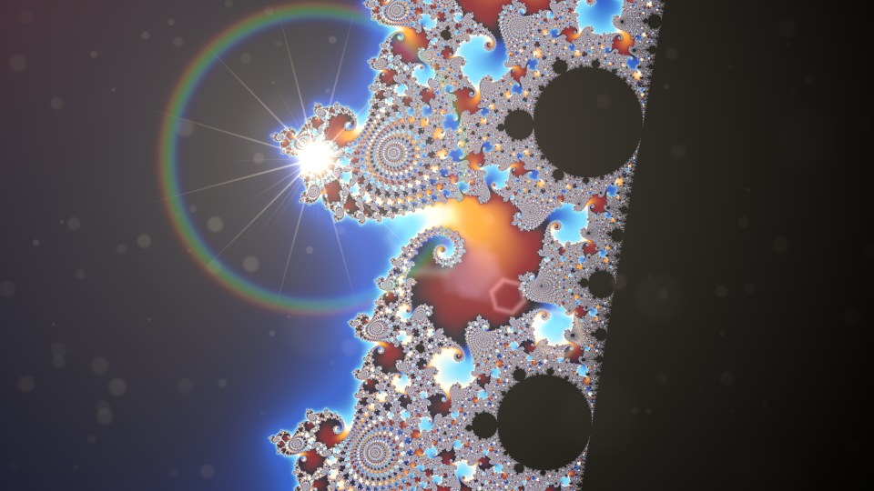

# Effects

The *Effects* section (below *Image* in the inspector) changes the finished picture, the way a
camera and its film would: brightness and tone, colors, glow and lens effects. The effects act
on the whole image after the layers are combined. Editing them does not render anew, so the
sliders answer at once; the preview and the exported image show the same.

## Tone

- **Exposure** brightens or darkens in stops: +1 doubles the light.
- **Tone mapping** brings light brighter than white back into range. *None* cuts it off;
  *Reinhard* is soft and keeps colors; *ACES* gives a film-like curve with rich contrast;
  *Filmic* (Hable's curve) has a gentle shoulder and lifted shadows; *AgX* lets very bright
  colors fade toward white like film does.
- **Contrast** and **Saturation**: 1 leaves the image unchanged.

## Color

- **Temperature** and **Tint** set the white balance: cooler or warmer, greener or more
  magenta. Gray keeps its brightness.
- **Split toning**: the dark parts take on the *Shadow tone*, the bright parts the *Highlight
  tone*, each by its amount.

## Glow

- **Bloom** spreads a soft glow around parts brighter than the *Bloom threshold* (after the
  exposure; 1 is white). *Bloom size* goes from a tight glow to a wide haze. Bright
  colorings, lit highlights and density layers glow best.
- **Streaks** draw lines of light through very bright parts, like a star filter: *Streak
  directions* 1 gives a line, 2 a cross, 3 and 4 stars; length, angle and tint as you like.

- **God rays** smear the light of parts brighter than their threshold toward a *Light
  position* (a share of the image width and height from the top left; it may lie outside
  the image): shafts of light, strongest where bright shapes stand in front of darkness.
  *Rays length* is how much of the way toward the light they reach.
- Lens flares come from light sources (see *Lights* below).

Glow also spreads over transparent parts of the image, which then become partly opaque.

## Lights

The *Lights* section (between *Image* and *Effects*) holds the document's light sources. A
light is a point in the plane: it moves with the fractal when you pan and zoom. **Add a
light** puts one at the center of the view. In the view every light shows as a small circle
(*View › Light gizmos* hides them); drag the circle to move the light, click it to select it.
The position fields hold the exact coordinates, so a light stays in place at any depth.

- **Height** is how high the light hangs above the plane, as a share of the image height. It
  matters for lit layers with *Document lights* (see *Lighting*) and in 3D terrain views,
  where the light hangs above the landscape at that height and its glow and flare show where
  the camera sees it; dragging its circle there moves it at its height. With a 3D object the
  view's plane is the ground through the object's center (one image height is the object's
  diameter) and the light hangs above it the same way. A light behind the terrain or the
  object fades out with its glow and flare.
- **Reach** makes the light it casts fall off with distance: at that distance (a share of the
  image height) half of it is left; 0 keeps it constant.
- **Color** and **Intensity** apply to the glow, the flare and the light it casts.
- **Visible** shows the light itself as a glow: *Soft* (a bright core with a long falloff),
  *Sharp* (a small spot), *Ball* (a glowing disc with a bright rim) or *Halo*, with its size
  (a share of the image height) and strength.
- **Lens flare** adds what a camera lens makes of a bright light. **Presets** give ready
  looks (Classic, Anamorphic, Sun, Star, Spike ball, Sci-fi, Subtle, Dirty lens) to start
  from. The parts:
  - *Core* and *Haze*: the bright center and a wide soft glow;
  - *Star rays* (a diffraction star, its length, width, angle and how uneven the spikes are)
    and *Fine spikes* (many thin random ones);
  - *Streak*: a long thin anamorphic line, with *Sparkles* along it;
  - *Ghosts*: reflections of the aperture on the line from the light through the image
    center, round or with *Aperture blades*, some hollow, in the light's color or in lens
    coating tints, with colored fringes (*Chromatic*); a *Bokeh image* can shape them.
    **Edit the ghosts one by one** turns them into a list: each ghost's place on the line
    (0 at the light, 1 at the image center), size, brightness, softness, tint and whether it
    is a ring; add and remove ghosts, or go *Back to generated*;
  - *Ring*: a halo around the light, optionally in rainbow colors;
  - *Dirt*: soft specks on the lens that light up near the light;
  - *Variation* picks another random layout of spikes, ghosts, sparkles and dirt.

The flare fades out as its light leaves the image. Glows and flares are light added before
the exposure and tone mapping, like the other glow effects; preview, exports and the command
line show the same. Keyframes move lights along with everything else.

## Levels and curve

- **Black point** and **White point** stretch the displayed values: everything at or below
  the black point becomes black, at or above the white point white. **Midtones** brightens
  (above 1) or darkens (below 1) the middle tones.
- The **tone curve** sets the output at five inputs (black, shadows, middle, lights, white);
  between them it bends smoothly. A straight line changes nothing, an S shape adds contrast.
  The small plot shows levels and curve together.

## Denoise

**Denoise exports** runs exported images and command line renders through Intel Open Image
Denoise before the other effects: grain from few samples (soft shadows, occlusion, glows,
density layers) disappears. The preview is not denoised. With lit layers or 3D objects the
export also renders two helper images with a few samples, the surface colors without light
and the surface directions, which keep edges and fine detail sharp; without them the
denoiser softens very fine detail such as thin filaments, and *Denoise amount* below 1 keeps
part of the original. The export
message says whether the image was denoised and on which device; without the library (see
*Installation*) the image is saved as it is.

## Lens and film

- **Sharpen** makes edges crisper.
- **Distortion** bends the image like a wide-angle lens (barrel, to the right) or a telephoto
  lens (pincushion, to the left).
- **Chromatic aberration** lets red and blue drift apart toward the edges; *Spectral* spreads
  seven wavelengths instead of three channels, for smooth rainbow fringes.
- **Vignette** darkens the corners, **Grain** adds a fixed film grain.

The reset button of the section switches every effect off.
