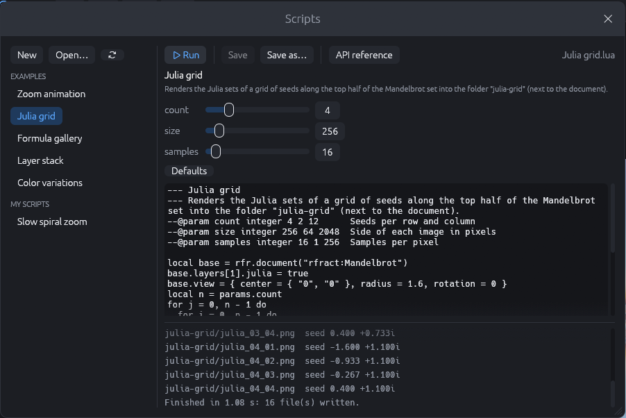

# Scripting

Lua scripts build and change documents, render images and animations and fill the render
queue: a zoom animation from a few parameters, a grid of Julia sets, a gallery of every
formula, the same picture in many color schemes.

## The Scripts window



*File › Scripts…* lists the example scripts and your own (the `scripts` folder in the settings
folder, see `rfr-cli info`). Choosing one shows its code, its description and a form of its
parameters. **Run** (Ctrl+Enter) runs the script on a copy of the current document; what the
script leaves in `doc` becomes the document, as one step that Undo takes back. Images and
movies the script renders are written while it runs, jobs it queues go into the render queue.
**Stop** ends the script (the document stays as it was). `print` lines and errors (with the
line number) appear below the code.

**New** starts a script from a template, **Save as…** keeps a changed example as your own
script, **Open…** reads a script from any folder.

## On the command line

```
rfr-cli script "Zoom animation.lua" picture.rfr -o zoom.rfr --param steps=10
rfr-cli script --info "Julia grid.lua"
rfr-cli script --examples ~/rfract-scripts
rfr-cli script --api
```

`script` runs a script on a document (or the default document) and saves what it leaves with
`-o`; `--param name=value` sets a parameter, `--info` lists them, `--examples` writes the
example scripts into a folder, `--api` prints this reference. Jobs the script queues are
added to the render queue file (`rfr-cli batch` renders them).


Scripts are Lua 5.4 (without file and system access of their own). A script works on the
global `doc`, the current document; what it leaves in `doc` becomes the document (one undo
step in the app). Paths are relative to the document's folder (or the script's folder when
the document has none).

## The script header

The first comment lines name the script and declare its parameters:

```lua
--- Zoom animation
--- Keyframes that zoom into the middle of the view.
--@param steps integer 6 1 40         Keyframes after the first
--@param factor number 0.1 0.001 0.9  Zoom of each step
--@param smooth bool true             Ease in and out
--@param style choice spiral|straight The kind of path
```

`--- ` lines: the title, then the description. `--@param <name> <type> <default> [min max]
[help]` with the types `number`, `integer`, `bool` and `choice` (options separated by `|`,
the first is the default). The values are in the global table `params` (`params.steps`).

## Documents

A document is a Lua table with the fields of an `.rfr` file: `doc.image` (`width`, `height`,
`samples`), `doc.view` (`center` as two strings, `radius`, `rotation`), `doc.layers` (a list,
the last one on top), `doc.post`, `doc.lights`, `doc.animation`. Fields left out take their
defaults. `print(rfr.dump(doc))` shows a whole document.

- `doc.layers[1].formula`: the formula id (`rfr.formulas()` lists them)
- `doc.layers[1].params.power`: a formula parameter (by name; `rfr.params(id)` lists them)
- `doc.layers[1].julia`, `.seed = {re, im}`: Julia mode
- `doc.layers[1].outside` / `.inside`: coloring (`transfer`, `density`, `offset`, `gradient`)
- `doc.layers[1].merge` (`"normal"`, `"screen"`, `"multiply"`, …), `.opacity`, `.visible`
- `doc.view.radius`: half the view height in the plane; numbers beyond double precision are
  strings (`"1e-80"`)

## The rfr module

- `rfr.version`: the program name and version
- `rfr.document([formula])`: a new document (the default one, or one of `formula` at its own
  view)
- `rfr.layer([formula])`: a new layer with the formula's defaults
- `rfr.copy(value)`: a deep copy of a table (a document to change without touching `doc`)
- `rfr.load(path)`: a document from an `.rfr` file or a PNG rendered by RFract
- `rfr.save(doc, path)`: writes an `.rfr` file; returns the full path
- `rfr.render(doc, path, [options])`: renders a PNG (with the document inside; posters above
  8K UHD in tiles); returns a summary. Options: `width`, `height`, `samples` (left out: the
  document's)
- `rfr.animate(doc, path, [options])`: renders the document's animation into a movie (by the
  extension: `.mp4`, `.mov`, `.webm`, `.gif`) or a folder of PNG images; options as for
  `render` plus `from`, `to` (frames) and `format` (`mp4`, `hevc`, `av1`, `prores`, `webm`,
  `gif`, `png`)
- `rfr.queue(doc, path, [options])`: adds a job to the render queue instead of rendering now
  (an animation when the document has keyframes and the path is not a `.png`, or
  `animation = true/false`)
- `rfr.formulas([kind])`: the formulas of a kind (`"fractal"`, `"coloring"`, `"transform"`,
  `"object"`; default fractals) as a list of `{id, title, family, kind}`
- `rfr.params(id)`: the parameters of a formula as a list of `{name, caption, kind, default,
  min, max, hint}`
- `rfr.zoom(doc, factor, [x, y])`: zooms the view by `factor` (0.5: twice as close) around
  the point `x`, `y` (in view radii from the middle; default the middle), exact at any depth
- `rfr.pan(doc, dx, dy)`: moves the view by `dx`, `dy` view radii
- `rfr.add_keyframe(doc, [frames])`: adds the document as it is now as a keyframe of its own
  animation (`frames` to the next keyframe, default 60); returns the number of keyframes
- `rfr.dump(value)`: a table as JSON text
- `print(...)`: writes a line to the script output

Renders run on the graphics card (the CPU without one). **Stop** ends a script between Lua
steps and between rendered images.

## Example

```lua
--- Three zooms
--@param factor number 0.25 0.01 0.9  Zoom per image
for i = 1, 3 do
  rfr.zoom(doc, params.factor)
  rfr.render(doc, string.format("zoom_%d.png", i), { width = 800, height = 450 })
end
```
